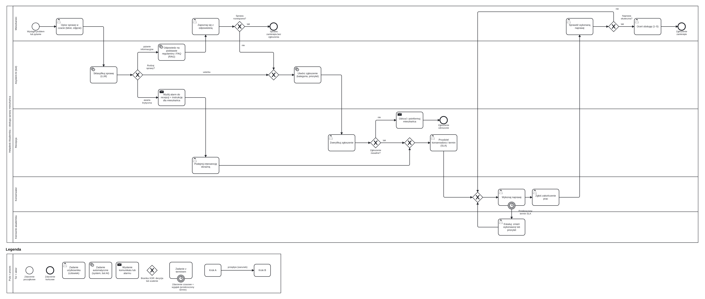

# Proces: obsługa sprawy mieszkańca (BPMN)

Pliki:
- `proces-zgloszenia.bpmn` - model (można otworzyć w https://demo.bpmn.io albo Camunda Modeler)
- `legenda.bpmn` - legenda użytych symboli
- `proces-zgloszenia.png` - eksport diagramu z legendą

## Opis

Proces zaczyna się, kiedy mieszkaniec pisze na czacie o problemie albo zadaje pytanie.
Asystent AI klasyfikuje sprawę i tu jest pierwsza decyzja:

- **pytanie** - asystent odpowiada z regulaminu/FAQ. Jeśli to wystarczy, sprawa się kończy.
  Jeśli nie, asystent zakłada zgłoszenie.
- **usterka** - asystent od razu zakłada zgłoszenie.
- **awaria krytyczna** - opisana niżej.

Recepcja sprawdza zgłoszenie. Jeśli jest bez sensu albo to duplikat, odrzuca je z podaniem powodu
i proces się kończy. W przeciwnym razie przydziela konserwatora i termin. Konserwator robi naprawę
i zgłasza, że skończył. Mieszkaniec sprawdza - jeśli dalej nie działa, zgłoszenie wraca do
konserwatora, a jeśli działa, mieszkaniec ocenia obsługę i zgłoszenie jest zamknięte.

## Sytuacje wyjątkowe

1. **Awaria krytyczna** - asystent od razu wysyła alarm do recepcji (a mieszkańcowi podstawową
   instrukcję, np. zakręcić zawór). Recepcja reaguje doraźnie i przydziela konserwatora bez
   normalnej weryfikacji.
2. **Przekroczony termin** - zdarzenie czasowe na zadaniu „Wykonaj naprawę”. Gdy termin minie,
   kierownik dostaje sprawę, zmienia wykonawcę albo priorytet i zgłoszenie wraca do realizacji.

## Legenda

Legenda jest na dole PNG. W skrócie:
- tory (poziome pasy) = aktorzy
- kółko cienkie / grube = start / koniec
- zadanie z ludzikiem = robi człowiek, z zębatką = automatycznie system (bot), z kopertą = wysłanie wiadomości
- romb z X = decyzja (albo połączenie ścieżek, jeśli nie ma podpisu)
- zegar na krawędzi zadania = przekroczenie terminu (wyjątek)
