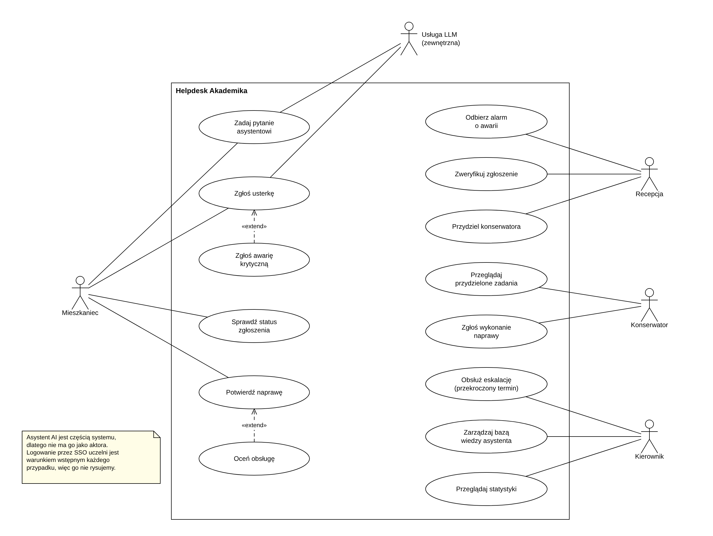

# Przypadki użycia

Źródło: `przypadki-uzycia.drawio` (draw.io / diagrams.net).

Asystenta AI nie ma na diagramie jako aktora, bo jest częścią naszego systemu. Logowania też
nie rysowaliśmy jako osobnego przypadku - jest warunkiem wstępnym dla wszystkich.

Poniżej opis dwóch najważniejszych przypadków.

---

## UC1: Zgłoś usterkę

**Aktor główny:** Mieszkaniec
**Aktor pomocniczy:** Usługa LLM
**Warunki początkowe:** mieszkaniec jest zalogowany i ma przypisany pokój.
**Warunki końcowe:** w systemie jest nowe zgłoszenie ze statusem „nowe”, mieszkaniec zna jego numer.

**Scenariusz główny:**
1. Mieszkaniec otwiera czat i opisuje problem (np. „cieknie kran w łazience”).
2. System przekazuje treść do modelu językowego, który rozpoznaje, że to usterka, i proponuje kategorię oraz priorytet.
3. System pyta o brakujące informacje (np. czy chodzi o łazienkę w pokoju czy wspólną).
4. Mieszkaniec odpowiada i opcjonalnie dodaje zdjęcie.
5. System pokazuje podsumowanie zgłoszenia (kategoria, priorytet, opis, lokalizacja).
6. Mieszkaniec zatwierdza.
7. System zapisuje zgłoszenie, nadaje numer i pokazuje go mieszkańcowi.

**Scenariusze alternatywne:**
- 2a. Model rozpoznaje pytanie, a nie usterkę - system odpowiada z regulaminu/FAQ (UC „Zadaj pytanie asystentowi”).
- 2b. Model rozpoznaje awarię krytyczną - wykonywany jest przypadek „Zgłoś awarię krytyczną” (rozszerzenie):
  system od razu wysyła alarm do recepcji i podaje mieszkańcowi instrukcję oraz numer portierni.
- 5a. Mieszkaniec nie zgadza się z kategorią - zmienia ją ręcznie i wraca do kroku 5.
- 6a. Mieszkaniec rezygnuje - zgłoszenie nie jest tworzone.

**Wyjątki:**
- usługa LLM nie odpowiada - system pokazuje zwykły formularz zgłoszenia (kategoria do wyboru z listy).

---

## UC2: Zweryfikuj zgłoszenie

**Aktor główny:** Recepcja
**Warunki początkowe:** pracownik recepcji jest zalogowany, istnieje zgłoszenie ze statusem „nowe”.
**Warunki końcowe:** zgłoszenie ma status „zweryfikowane” albo „odrzucone”.

**Scenariusz główny:**
1. Pracownik otwiera listę nowych zgłoszeń (posortowaną po priorytecie).
2. Wybiera zgłoszenie i przegląda opis, zdjęcia oraz historię czatu.
3. System pokazuje ewentualne podobne zgłoszenia z ostatnich 7 dni.
4. Pracownik sprawdza kategorię i priorytet (może je poprawić).
5. Pracownik zatwierdza zgłoszenie.
6. System zmienia status na „zweryfikowane” i przechodzi do przydziału konserwatora (UC „Przydziel konserwatora”).

**Scenariusze alternatywne:**
- 3a. Zgłoszenie jest duplikatem - pracownik łączy je z istniejącym, mieszkaniec dostaje informację i numer tamtego zgłoszenia.
- 5a. Zgłoszenie jest niezasadne (np. nie dotyczy akademika) - pracownik odrzuca je i wpisuje powód.
  System ustawia status „odrzucone” i wysyła powód mieszkańcowi.
- 2a. Brakuje informacji - pracownik dopisuje pytanie do mieszkańca, zgłoszenie czeka na odpowiedź.
