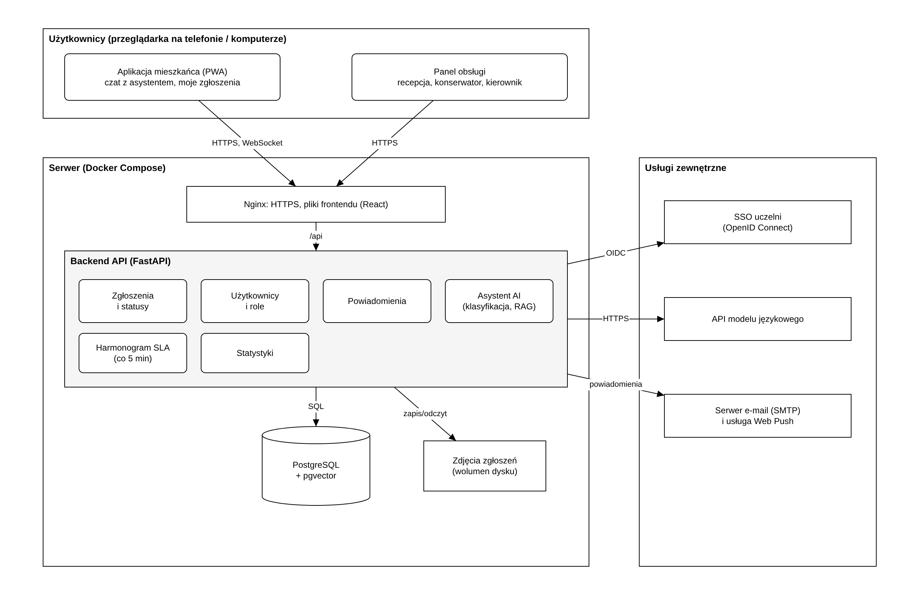

# Architektura systemu

Źródło: `architektura.drawio`.

Robimy klasyczną aplikację klient-serwer. Frontend to jedna aplikacja React z dwoma widokami:
dla mieszkańca (czat, moje zgłoszenia) i panel dla obsługi. Całość stoi w kontenerach Dockera na jednym serwerze.

Elementy:
- **Nginx** - HTTPS, serwuje zbudowany frontend i przekazuje `/api` do backendu.
- **Backend (FastAPI)** - jeden serwis podzielony na moduły: zgłoszenia, użytkownicy i role,
  powiadomienia, asystent AI, statystyki. Harmonogram co kilka minut sprawdza terminy (SLA) i robi eskalacje.
- **PostgreSQL z pgvector** - zwykłe dane (zgłoszenia, użytkownicy) i wektory fragmentów regulaminu/FAQ do wyszukiwania.
- **Zdjęcia** - pliki na wolumenie dysku, w bazie trzymamy tylko ścieżki.
- **Usługi zewnętrzne** - SSO uczelni do logowania, API modelu językowego dla asystenta, SMTP i Web Push do powiadomień.

## Jak przechodzi zgłoszenie przez system

1. Mieszkaniec pisze na czacie, wiadomość idzie przez WebSocket do backendu.
2. Moduł asystenta wyszukuje pasujące fragmenty regulaminu w bazie (pgvector) i wysyła je razem z pytaniem do API modelu.
3. Model zwraca odpowiedź albo klasyfikację (pytanie / usterka / awaria krytyczna).
4. Przy usterce backend zapisuje zgłoszenie w bazie, a moduł powiadomień informuje recepcję.
5. Dalej obsługa idzie przez panel (zwykłe REST API).

Nie robimy mikroserwisów, bo przy naszej skali i dwóch osobach w zespole to by tylko komplikowało projekt.
Moduł asystenta jest wydzielony w kodzie, więc w razie potrzeby da się go potem przenieść do osobnego serwisu.
